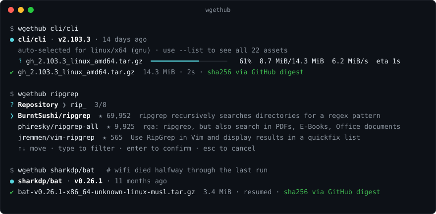
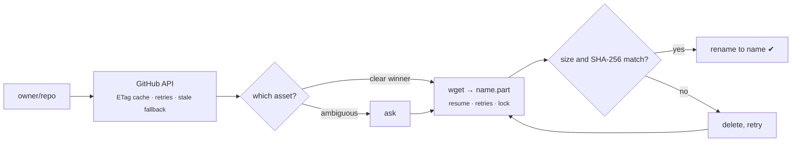

<h1 align="center">wgethub</h1>

<p align="center">
  <b>The unreasonably robust way to <code>wget</code> a GitHub release.</b><br>
  It picks the right file for your machine, resumes, retries, and proves the bytes are correct.
</p>

<p align="center">
  <a href="https://github.com/pxlkt/wgethub/actions/workflows/ci.yml"></a>
  
  
  = 20" src="https://img.shields.io/badge/node-%E2%89%A5%2020-5fa04e?logo=node.js&logoColor=white">
  <a href="LICENSE"></a>
</p>

<p align="center"></p>

```sh
wgethub cli/cli
```

That is the whole command. wgethub finds the latest release, works out that you are on (say) x86-64 Linux, hands the right tarball to `wget`, and refuses to give you the file until its SHA-256 matches what GitHub published.

## Why

Version 1 was a 100-line script written in half an hour so a friend could stop pasting release URLs. It worked, as long as the network behaved, the repo existed, and nobody pressed Ctrl-C.

Version 2 is the same idea with every one of those assumptions removed. It is still, at heart, a program that runs `wget`. It is just extremely thorough about it.

## Install

You need [Node.js](https://nodejs.org) 20 or newer and `wget` (GNU Wget, Wget2 and BusyBox wget are all detected and handled).

```sh
npm install -g github:pxlkt/wgethub
```

Or run it once without installing:

```sh
npx github:pxlkt/wgethub cli/cli
```

Check your setup with `wgethub --doctor`.

## Usage

```sh
wgethub                                  # interactive: search, pick a release, pick files
wgethub BurntSushi/ripgrep               # latest release, asset auto-selected for this machine
wgethub BurntSushi/ripgrep@14.1.0        # a specific tag (the "v" prefix is optional either way)
wgethub neovim/neovim '*.appimage'       # choose assets by substring or glob
wgethub sharkdp/bat --os windows --arch arm64   # download for a different machine
wgethub cli/cli --all -o ./downloads -j 6       # everything, six at a time
wgethub torvalds/linux --source          # source tarball instead of release assets
wgethub cli/cli -- --limit-rate=2m       # anything after -- is passed straight to wget
wgethub ripgrep                          # not sure of the owner? bare words search GitHub
```

Anything that points at a repository is accepted: `owner/repo`, `owner/repo@tag`, `github.com/owner/repo`, an SSH remote, or a URL copied from a release page or a download button.

Look before you download:

```sh
wgethub cli/cli --list        # assets in the release; ★ marks the one that fits your machine
wgethub cli/cli --releases    # all releases
wgethub cli/cli --print-url   # just the URL
wgethub cli/cli --dry-run     # the exact wget command, ready to paste
```

Run `wgethub --help` for every option.

## What "unreasonably robust" means

| When this happens | wgethub does this |
| --- | --- |
| The connection drops mid-download | wget retries and resumes with a `Range` request. If wget itself gives up, wgethub restarts it with exponential backoff, still resuming. |
| You press Ctrl-C, or the laptop sleeps | The partial file is kept as `name.part`. Run the same command again and it continues from where it stopped. |
| The download is silently corrupted | The file is hashed and compared with the release's SHA-256 before it gets its real name. On a mismatch the bad bytes are deleted and fetched again from scratch. |
| The release predates GitHub's asset digests | It looks for `SHA256SUMS`, `*_checksums.txt` or `<asset>.sha256` in the same release and verifies against that. Failing that, it checks the size and tells you so. |
| The file is already there | It is verified in place and skipped. A *different* file with the same name is never overwritten without `--force`. |
| A release has 30 assets | Names are scored against your OS, CPU and libc. A clear winner is used; a tie is never guessed, you are asked instead. |
| You are rate limited, or GitHub is down | Responses are cached with their ETags and revalidated with conditional requests. If the API is unreachable, the cached release data is used with a warning. |
| The repo is private | Your token is sent to the GitHub API only. wget receives a short-lived signed URL, so the token never appears in a process list. |
| Two wgethubs target the same file | A lock file makes the second one stop instead of interleaving bytes. Locks left by dead processes are taken over. |
| A release asset is named `../../.bashrc` | Refused. Asset names cannot escape the output directory. |
| The repo only ships pre-releases, or the tag is `1.2.3` not `v1.2.3` | It finds the release anyway and tells you what it did. |
| The system `wget` is BusyBox or Wget2 | It is detected and given only the flags it understands. |

The invariant behind most of this: **a file without the `.part` suffix is always complete and verified.**



## Scripting

Human-readable output goes to **stderr**. **stdout** carries only results, so pipes stay clean:

```sh
tar -xzf "$(wgethub cli/cli -q)"                 # stdout is the path of the downloaded file
wgethub cli/cli --json | jq -r '.files[].checksum'
curl -LO "$(wgethub cli/cli --print-url -q)"     # if you must
```

Prompts only ever appear on an interactive terminal. In a pipe, in CI, or with `--yes`, wgethub fails with a clear message instead of waiting for input.

### Exit codes

| Code | Meaning |
| ---: | --- |
| 0 | Success |
| 1 | Unexpected failure (network unreachable, API error) |
| 2 | Bad usage, or a choice that needs a human |
| 3 | Repository, release or asset not found |
| 4 | Rate limited, or the token was rejected |
| 5 | `wget` is not installed |
| 6 | Download failed |
| 7 | Checksum verification failed |
| 130 | Interrupted (partial files kept for resuming) |

## Authentication and rate limits

Anonymous use is limited by GitHub to 60 API requests per hour. A typical download costs one. With a token the limit is 5,000 and private repositories work.

wgethub looks for a token in this order: `GITHUB_TOKEN`, `GH_TOKEN`, then the [GitHub CLI](https://cli.github.com)'s stored login (`gh auth token`). Pass `--no-auth` to ignore all three.

| Variable | Purpose |
| --- | --- |
| `GITHUB_TOKEN`, `GH_TOKEN` | API token |
| `WGETHUB_API_URL` | API base URL, for GitHub Enterprise Server (`https://ghe.example.com/api/v3`) |
| `WGETHUB_WGET` | Path to the `wget` binary to use |
| `WGETHUB_CACHE_DIR` | Where API responses are cached (default: `~/.cache/wgethub`) |
| `NO_COLOR` | Disable colours |

## A note on what verification proves

A matching SHA-256 proves you received exactly the bytes GitHub is serving for that release. It protects against corruption, truncation and interference in transit. It does not prove the release itself is trustworthy: the checksum comes from the same place as the file. For that you still need to trust the publisher, or verify a signature.

## Development

```sh
git clone https://github.com/pxlkt/wgethub && cd wgethub
npm install
npm run dev -- cli/cli --list   # runs the TypeScript directly (Node 22.18+)
npm test                        # unit tests plus end-to-end tests against a fake GitHub
npm run typecheck
```

There are no runtime dependencies. The argument parser, fuzzy picker, progress display and API client are all in `src/`, about 2,300 lines of strict TypeScript. The end-to-end tests run the real CLI and the real `wget` against a local server that drops connections and serves wrong checksums on purpose.

## Upgrading from v1

`./wgethub` with no arguments still walks you through everything interactively. The `-nv` / `--no-validate` flag is accepted and ignored: v2 makes a single API request without it.

## License

[MIT](LICENSE)
